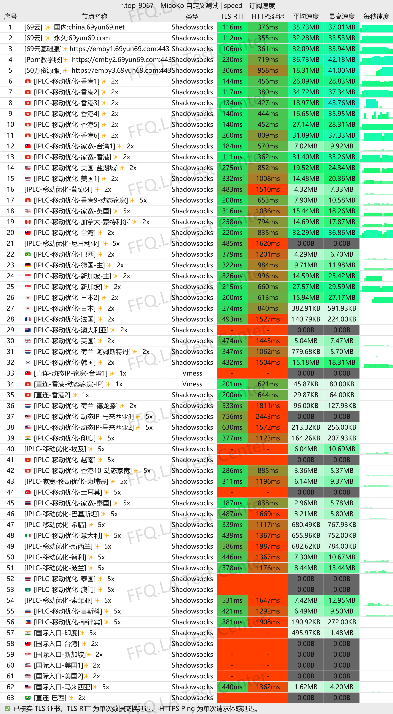
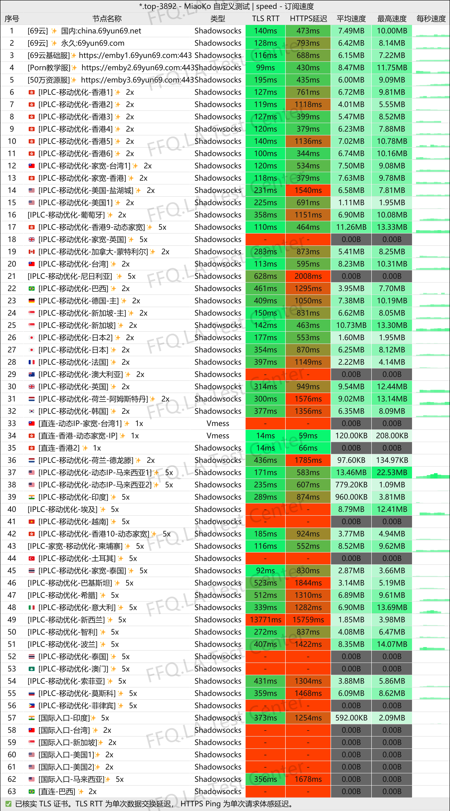
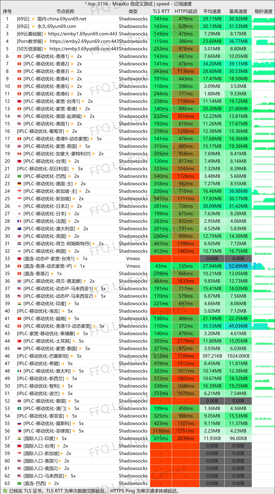
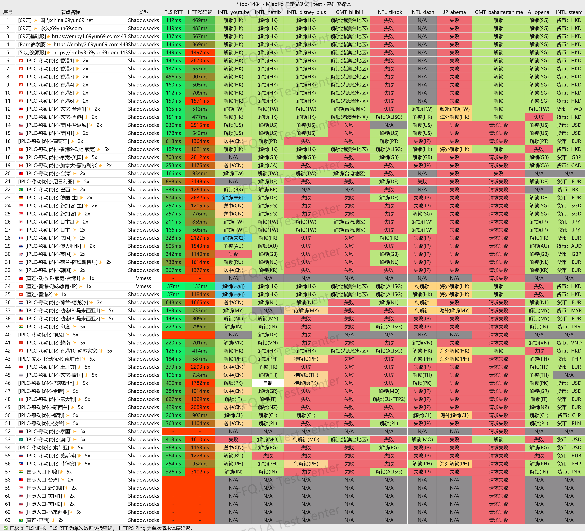
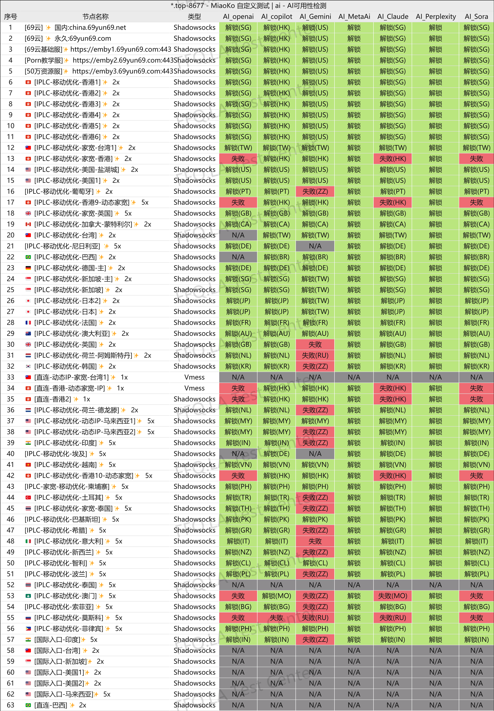
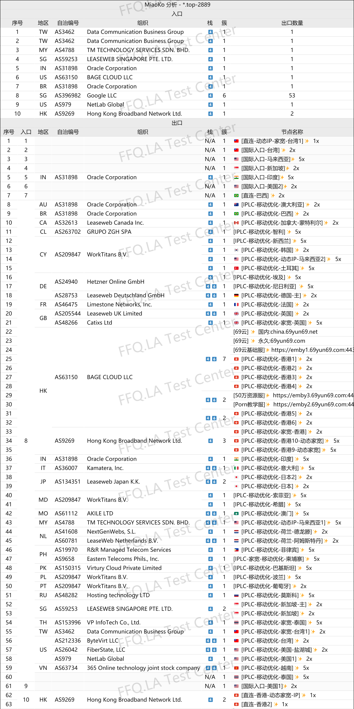

🇨🇳 [中文](README.md) | 🇺🇸 English | 🇷🇺 [Русский](README_RU.md) | 🇮🇷 [فارسی](README_FA.md)

# 69Yun VPN Official Website (Updated November 4, 2026)

Official 69Yun VPN Website<br>
Latest URL 01: [china.69yun69.net](https://to.iix.im/6903)<br>
Latest URL 02: [69yun69.net](https://to.iix.im/6902)<br>
Official URL: [69yun69.com](https://to.iix.im/6901)<br>

Best VPN Recommendations and Server List for 2026: [https://github.com/jdnei/JiChangTuiJian](https://github.com/jdnei/JiChangTuiJian)<br>

## Telegram VPN Deals & Community #AD
[VPN Giveaways](https://331024.de/archives/choujiang) | [VPN Chat Group](https://331024.de/archives/choujiang) | [VPN Trial Group](https://331024.de/archives/choujiang)<br>

[https://331024.de/archives/choujiang](https://331024.de/archives/choujiang)

## Promo Code / Discount Code
`Promotion Period: September 25 – October 2 (Year Not Specified)`

```bash
69yun-78%off
```

## Overview
69Yun VPN is a proxy and VPN service platform focused on providing fast and stable internet connections. It offers servers in multiple regions, relay connections, and dedicated-line routes.

The service is designed for everyday web browsing, video streaming, entertainment, and other online activities. It also features a daily check-in reward system that allows users to receive additional data allowances.

## Advantages
69Yun VPN stands out for its wide selection of network routes, offering both relay servers and dedicated-line connections to balance connection speed and stability.

Its server network covers multiple popular regions, making it suitable for web browsing, HD video streaming, and multi-device usage.

The platform allows users to earn additional data through daily check-ins. New users can also test the service before committing to a subscription.

With flexible pricing plans and various data allowances, 69Yun VPN is suitable for both everyday primary use and backup VPN requirements.

## Pricing Plans

| Plan | Price | Data Allowance | Validity / Billing Period | Concurrent Devices | Maximum Speed | Main Features |
| --- | ---: | ---: | --- | ---: | --- | --- |
| 🎉 Special Treat Plan | 13.36 | 100 GB | 30 Days (Unused Data Expires) | 10 Devices | No Speed Cap | China Mobile-Optimized IPLC Dedicated Lines, ChatGPT Access, 69Yun Basic Emby, Netflix / Streaming Unblocking, YouTube 4K |
| 🍃 Eat Well Plan | 19.18 | 400 GB | 30 Days (Unused Data Expires) | 10 Devices | No Speed Cap | China Mobile-Optimized IPLC Dedicated Lines, ChatGPT Access, 500,000-Item Emby Library + 69Yun Basic Service, Netflix / Streaming Unblocking, YouTube 4K |
| 🌟 Eat Your Fill Plan | 32.73 | 800 GB | 30 Days (Unused Data Expires) | 10 Devices | No Speed Cap | China Mobile-Optimized IPLC Dedicated Lines, ChatGPT Access, 500,000-Item Emby Library + 69Yun Basic Service, Netflix / Streaming Unblocking, YouTube 4K |
| 👑 Fully Stuffed Plan | 52.08 | 1600 GB | 30 Days (Unused Data Expires) | 10 Devices | No Speed Cap | China Mobile-Optimized IPLC Dedicated Lines, ChatGPT Access, 500,000-Item Emby Library + 69Yun Basic Service, Netflix / Streaming Unblocking, YouTube 4K |
| 👑 Ultimate Feast Plan | 57.90 | 2000 GB | 30 Days (Unused Data Expires) | 10 Devices | No Speed Cap | China Mobile-Optimized IPLC Dedicated Lines, ChatGPT Access, 500,000-Item Emby Library + 69Yun Basic Service, Netflix / Streaming Unblocking, YouTube 4K |
| 🍃 King Plan | 72.31 | 50 GB | 9,999 Days (Unused Data Expires) | 10 Devices | No Speed Cap | China Mobile-Optimized IPLC Dedicated Lines, ChatGPT Access, 69Yun Basic Emby, Netflix / Streaming Unblocking, YouTube 4K |
| 🍃 400G Partner Plan | 1918.00 | 400 GB | 30 Days (Unused Data Expires) | 10 Devices | No Speed Cap | Partner-Exclusive Plan, China Mobile-Optimized IPLC Dedicated Lines, ChatGPT Access, 500,000-Item Emby Library + 69Yun Basic Service, Netflix / Streaming Unblocking, YouTube 4K |
| 🍃 800G Partner Plan | 3273.00 | 800 GB | 30 Days (Unused Data Expires) | 10 Devices | No Speed Cap | Partner-Exclusive Plan, China Mobile-Optimized IPLC Dedicated Lines, ChatGPT Access, 500,000-Item Emby Library + 69Yun Basic Service, Netflix / Streaming Unblocking, YouTube 4K |

## 📊 Performance Tests & Analysis

#### 1.1 China Unicom Evening Peak-Hour Speed Test
<br>

#### 1.2 China Telecom Evening Peak-Hour Speed Test
<br>

#### 1.3 China Mobile Evening Peak-Hour Speed Test
<br>

#### 2. Streaming Service Unblocking Report
<br>

#### 3. AI Service Unblocking Report
<br>

#### 4. Entry and Exit Node Analysis
<br>
