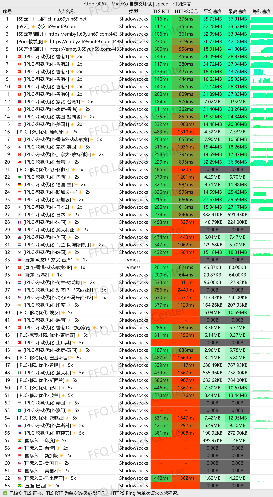
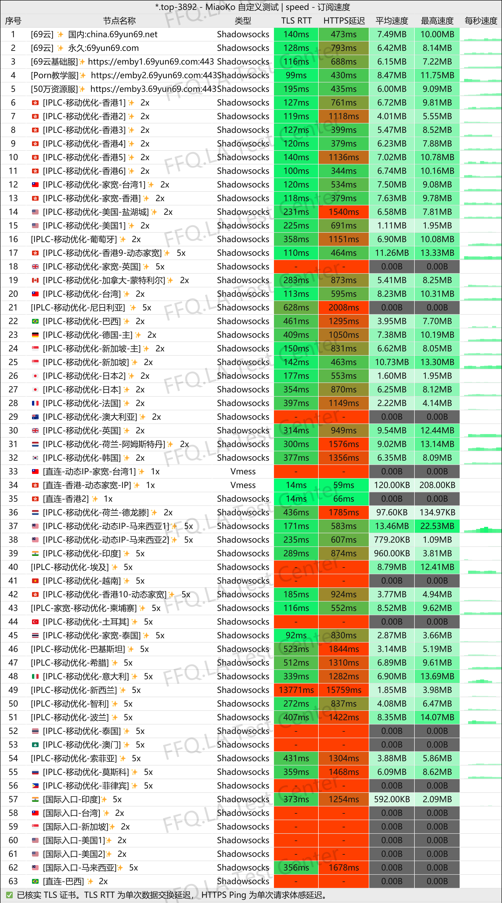
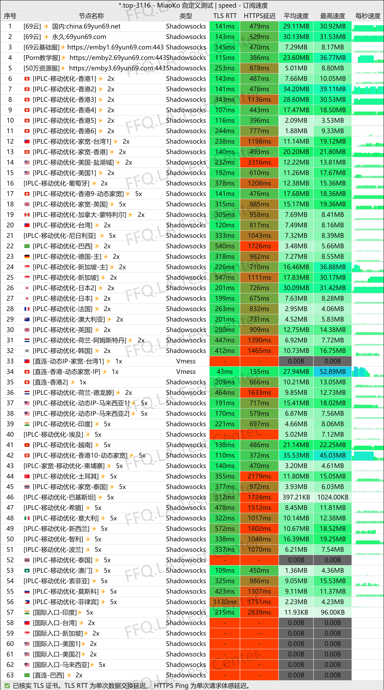
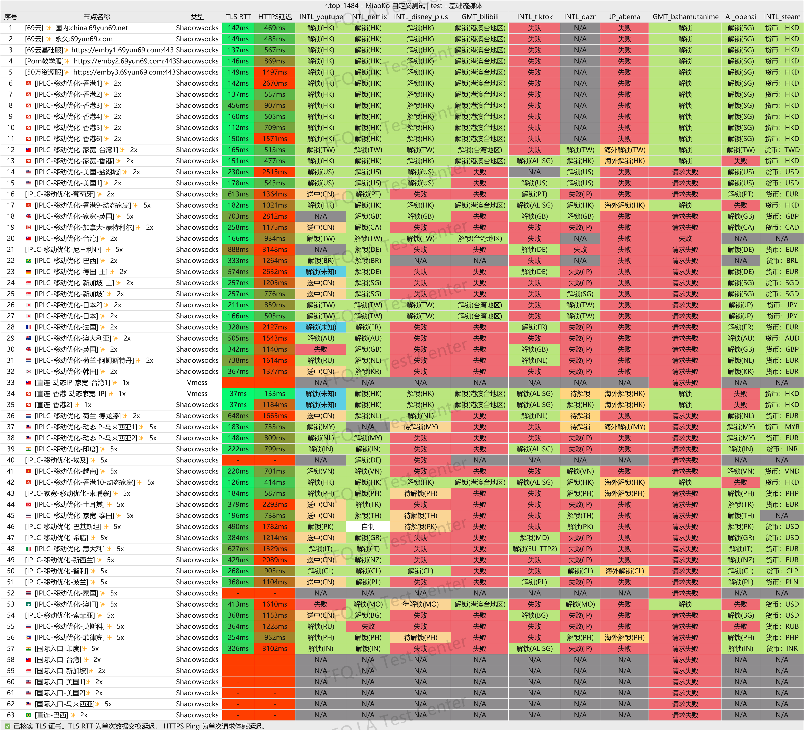
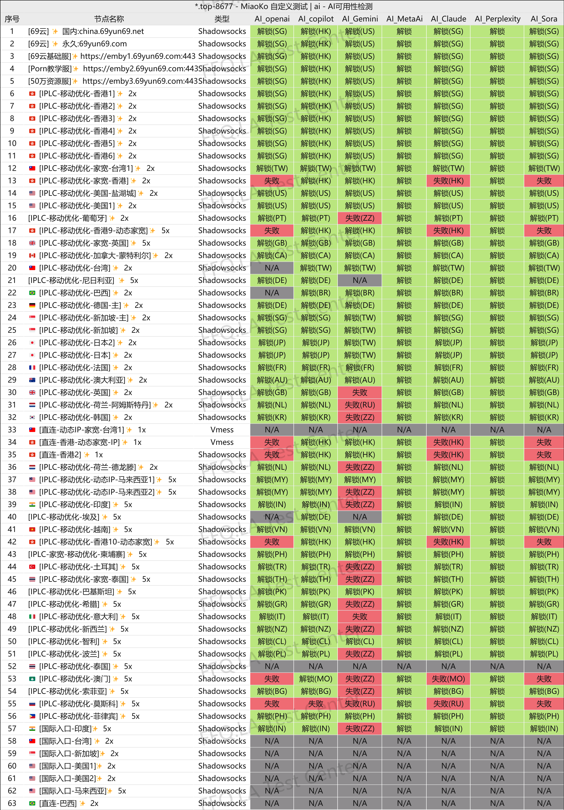
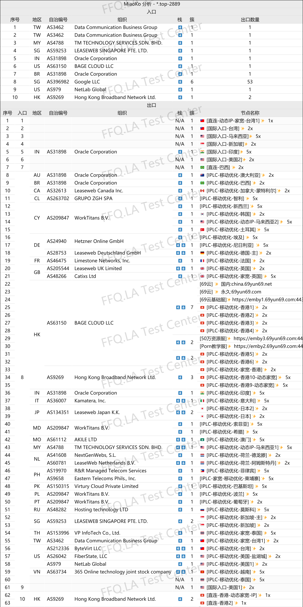

 🇨🇳 [中文](README.md) | 🇺🇸 [English](README_EN.md) | 🇷🇺 [Русский](README_RU.md) | 🇮🇷 فارسی

# وب‌سایت رسمی 69Yun VPN(به‌روزرسانی 10 نوامبر 2026)
وب‌سایت رسمی 69Yun VPN<br>
آخرین آدرس ۰۱: [china.69yun69.net](https://to.iix.im/6903)<br>
آخرین آدرس ۰۲: [69yun69.net](https://to.iix.im/6902)<br>
آدرس رسمی: [69yun69.com](https://to.iix.im/6901)<br>

معرفی بهترین سرویس‌ها و سرورهای VPN در سال ۲۰۲۶: [https://github.com/jdnei/JiChangTuiJian](https://github.com/jdnei/JiChangTuiJian)<br>

## انجمن و پیشنهادهای ویژه VPN در تلگرام #AD
[قرعه‌کشی VPN](https://331024.de/archives/choujiang) | [گروه گفت‌وگوی VPN](https://331024.de/archives/choujiang) | [گروه آزمایش VPN](https://331024.de/archives/choujiang)<br>

[https://331024.de/archives/choujiang](https://331024.de/archives/choujiang)

## کد تخفیف
`دوره تخفیف: ۲۵ سپتامبر تا ۲ اکتبر (سال مشخص نشده است)`

```bash
69yun-78%off
```

## معرفی
69Yun VPN یک پلتفرم ارائه‌دهنده خدمات پروکسی و VPN است که بر اتصال اینترنت پرسرعت و پایدار تمرکز دارد. این سرویس سرورهایی در مناطق مختلف، اتصالات رله و مسیرهای اختصاصی ارائه می‌کند.

این سرویس برای مرور روزمره وب، تماشای ویدئوهای آنلاین، سرگرمی و سایر فعالیت‌های اینترنتی طراحی شده است. همچنین دارای سیستم پاداش ثبت حضور روزانه است که به کاربران امکان دریافت حجم ترافیک اضافی را می‌دهد.

## مزایا
مهم‌ترین مزیت 69Yun VPN تنوع بالای مسیرهای ارتباطی آن است. این سرویس با ارائه سرورهای رله و خطوط اختصاصی، تعادلی میان سرعت اتصال و پایداری شبکه برقرار می‌کند.

شبکه سرورهای آن مناطق محبوب متعددی را پوشش می‌دهد و برای مرور وب، تماشای ویدئوهای باکیفیت و استفاده هم‌زمان از چند دستگاه مناسب است.

این پلتفرم به کاربران امکان می‌دهد از طریق ثبت حضور روزانه حجم ترافیک اضافی دریافت کنند. کاربران جدید نیز می‌توانند پیش از خرید اشتراک، سرویس را آزمایش کنند.

با توجه به طرح‌های متنوع و حجم‌های مختلف ترافیک، 69Yun VPN هم برای استفاده روزمره به‌عنوان VPN اصلی و هم به‌عنوان VPN پشتیبان مناسب است.

## طرح‌های اشتراک

| طرح | قیمت | حجم ترافیک | مدت اعتبار / دوره | دستگاه‌های هم‌زمان | حداکثر سرعت | ویژگی‌های اصلی |
| --- | ---: | ---: | --- | ---: | --- | --- |
| 🎉 طرح پذیرایی ویژه | 13.36 | 100 GB | ۳۰ روز (حجم باقی‌مانده پس از انقضا حذف می‌شود) | ۱۰ دستگاه | بدون محدودیت سرعت | خطوط اختصاصی IPLC بهینه‌شده برای China Mobile، دسترسی به ChatGPT، سرویس پایه Emby از 69Yun، رفع محدودیت Netflix و استریم، پشتیبانی از YouTube 4K |
| 🍃 طرح غذای خوب | 19.18 | 400 GB | ۳۰ روز (حجم باقی‌مانده پس از انقضا حذف می‌شود) | ۱۰ دستگاه | بدون محدودیت سرعت | خطوط اختصاصی IPLC بهینه‌شده برای China Mobile، دسترسی به ChatGPT، کتابخانه Emby با ۵۰۰ هزار محتوا + سرویس پایه 69Yun، رفع محدودیت Netflix و استریم، پشتیبانی از YouTube 4K |
| 🌟 طرح غذای کامل | 32.73 | 800 GB | ۳۰ روز (حجم باقی‌مانده پس از انقضا حذف می‌شود) | ۱۰ دستگاه | بدون محدودیت سرعت | خطوط اختصاصی IPLC بهینه‌شده برای China Mobile، دسترسی به ChatGPT، کتابخانه Emby با ۵۰۰ هزار محتوا + سرویس پایه 69Yun، رفع محدودیت Netflix و استریم، پشتیبانی از YouTube 4K |
| 👑 طرح کاملاً سیر | 52.08 | 1600 GB | ۳۰ روز (حجم باقی‌مانده پس از انقضا حذف می‌شود) | ۱۰ دستگاه | بدون محدودیت سرعت | خطوط اختصاصی IPLC بهینه‌شده برای China Mobile، دسترسی به ChatGPT، کتابخانه Emby با ۵۰۰ هزار محتوا + سرویس پایه 69Yun، رفع محدودیت Netflix و استریم، پشتیبانی از YouTube 4K |
| 👑 طرح ضیافت بزرگ | 57.90 | 2000 GB | ۳۰ روز (حجم باقی‌مانده پس از انقضا حذف می‌شود) | ۱۰ دستگاه | بدون محدودیت سرعت | خطوط اختصاصی IPLC بهینه‌شده برای China Mobile، دسترسی به ChatGPT، کتابخانه Emby با ۵۰۰ هزار محتوا + سرویس پایه 69Yun، رفع محدودیت Netflix و استریم، پشتیبانی از YouTube 4K |
| 🍃 طرح پادشاه | 72.31 | 50 GB | ۹۹۹۹ روز (حجم باقی‌مانده پس از انقضا حذف می‌شود) | ۱۰ دستگاه | بدون محدودیت سرعت | خطوط اختصاصی IPLC بهینه‌شده برای China Mobile، دسترسی به ChatGPT، سرویس پایه Emby از 69Yun، رفع محدودیت Netflix و استریم، پشتیبانی از YouTube 4K |
| 🍃 طرح همکاری 400G | 1918.00 | 400 GB | ۳۰ روز (حجم باقی‌مانده پس از انقضا حذف می‌شود) | ۱۰ دستگاه | بدون محدودیت سرعت | ویژه همکاران فروش، خطوط اختصاصی IPLC بهینه‌شده برای China Mobile، دسترسی به ChatGPT، کتابخانه Emby با ۵۰۰ هزار محتوا + سرویس پایه 69Yun، رفع محدودیت Netflix و استریم، پشتیبانی از YouTube 4K |
| 🍃 طرح همکاری 800G | 3273.00 | 800 GB | ۳۰ روز (حجم باقی‌مانده پس از انقضا حذف می‌شود) | ۱۰ دستگاه | بدون محدودیت سرعت | ویژه همکاران فروش، خطوط اختصاصی IPLC بهینه‌شده برای China Mobile، دسترسی به ChatGPT، کتابخانه Emby با ۵۰۰ هزار محتوا + سرویس پایه 69Yun، رفع محدودیت Netflix و استریم، پشتیبانی از YouTube 4K |

## 📊 آزمایش عملکرد و تحلیل

#### 1.1 آزمایش سرعت China Unicom در ساعات اوج مصرف شبانه
<br>

#### 1.2 آزمایش سرعت China Telecom در ساعات اوج مصرف شبانه
<br>

#### 1.3 آزمایش سرعت China Mobile در ساعات اوج مصرف شبانه
<br>

#### 2. گزارش رفع محدودیت سرویس‌های پخش آنلاین
<br>

#### 3. گزارش رفع محدودیت خدمات هوش مصنوعی
<br>

#### 4. تحلیل سرورهای ورودی و خروجی
<br>
