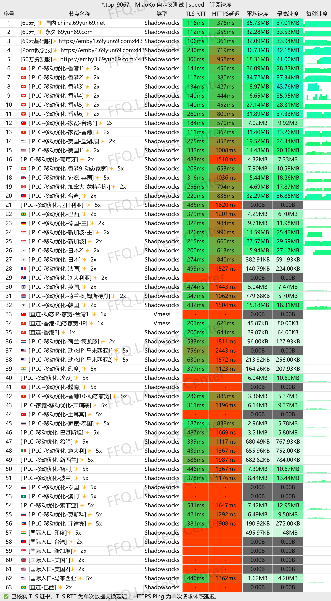
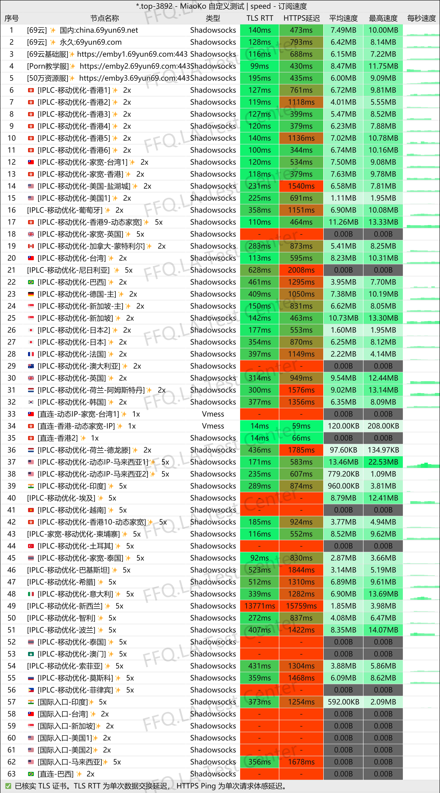
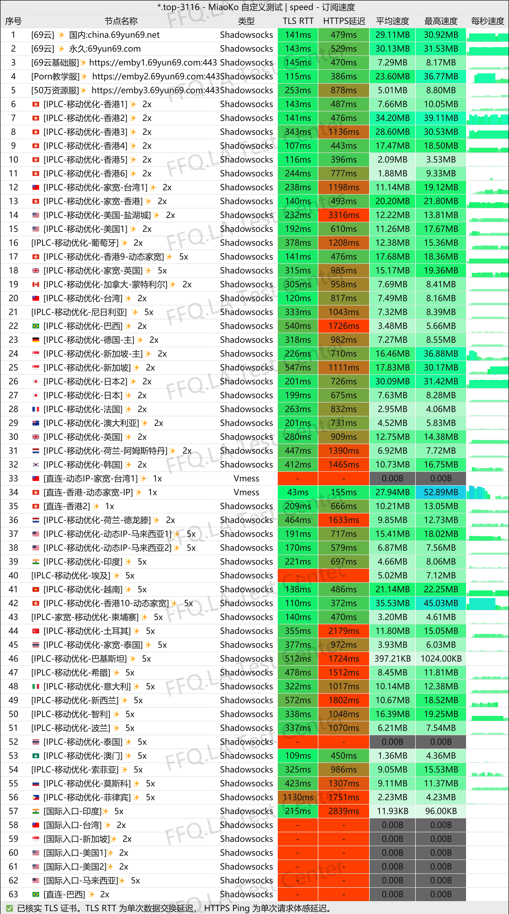
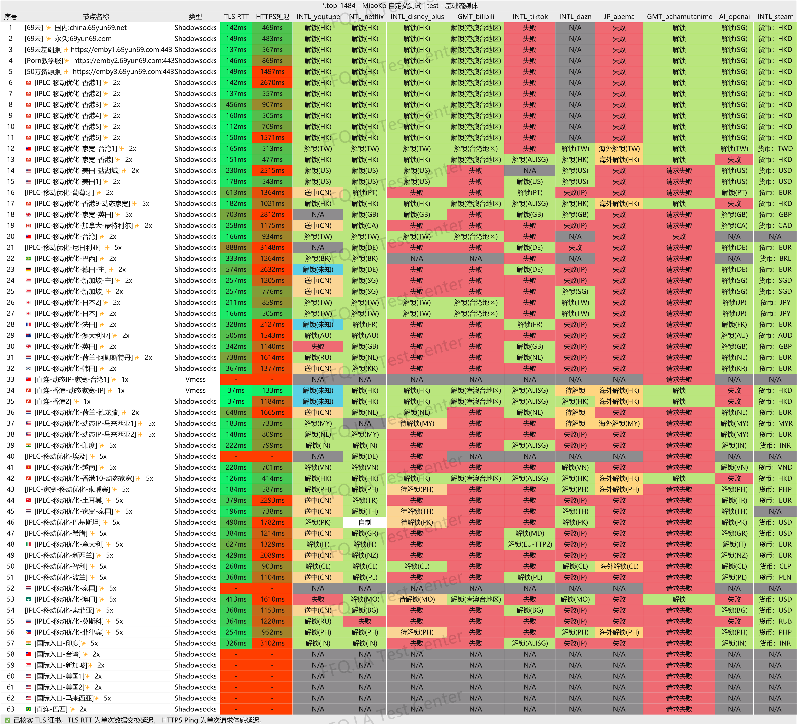
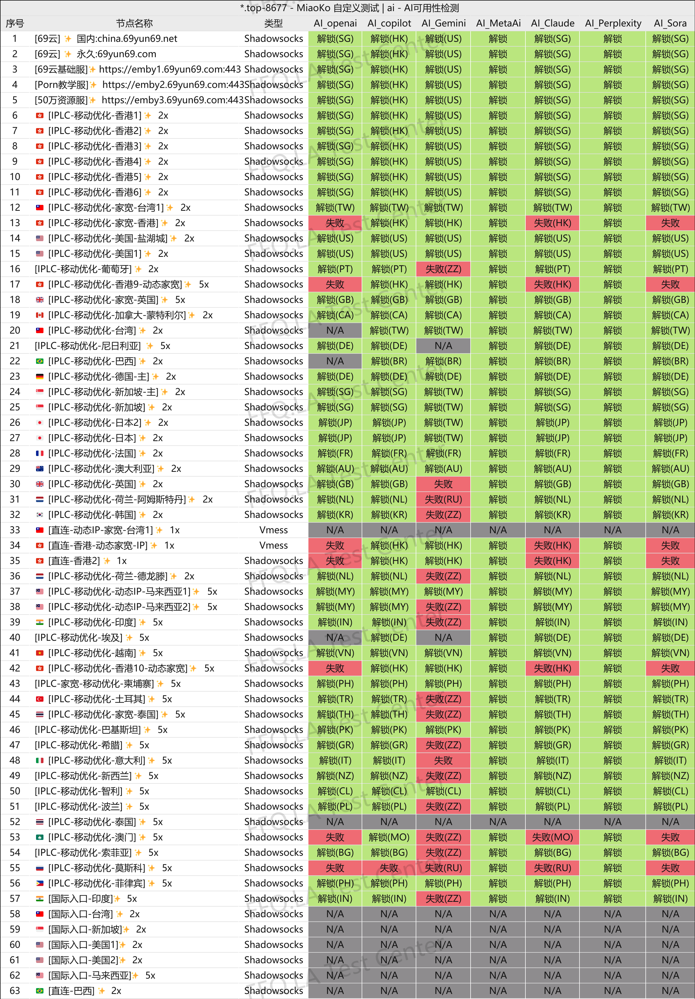
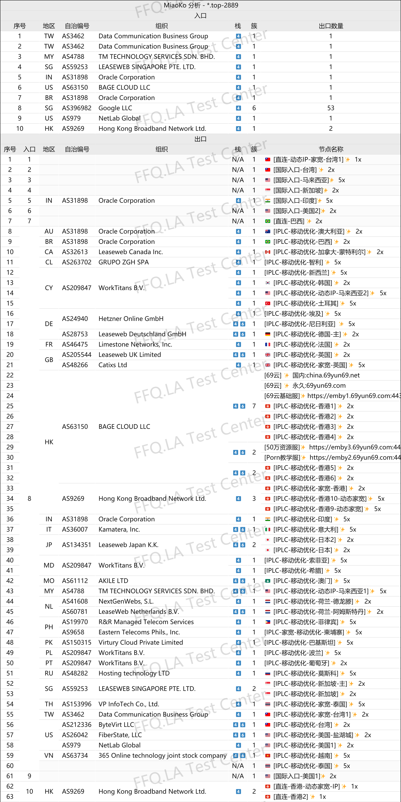

🇨🇳 [中文](README.md) | 🇺🇸 [English](README_EN.md) | 🇷🇺 Русский | 🇮🇷 [فارسی](README_FA.md)

# Официальный сайт 69Yun VPN (обновлено 13 ноября 2026)

Официальный сайт 69Yun VPN<br>
Актуальный адрес 01: [china.69yun69.net](https://to.iix.im/6903)<br>
Актуальный адрес 02: [69yun69.net](https://to.iix.im/6902)<br>
Официальный адрес: [69yun69.com](https://to.iix.im/6901)<br>

Лучшие VPN-сервисы и серверы на 2026 год: [https://github.com/jdnei/JiChangTuiJian](https://github.com/jdnei/JiChangTuiJian)<br>

## Telegram: VPN-сообщество и специальные предложения #AD
[Розыгрыши VPN](https://331024.de/archives/choujiang) | [Чат о VPN](https://331024.de/archives/choujiang) | [Группа тестирования VPN](https://331024.de/archives/choujiang)<br>

[https://331024.de/archives/choujiang](https://331024.de/archives/choujiang)

## Промокод / Код скидки
`Период акции: 25 сентября – 2 октября (год не указан)`

```bash
69yun-78%off
```

## Обзор
69Yun VPN — платформа прокси- и VPN-услуг, ориентированная на высокую скорость и стабильность интернет-соединения. Сервис предлагает серверы в различных регионах, ретрансляционные соединения и выделенные сетевые маршруты.

Он предназначен для повседневного просмотра веб-сайтов, потокового видео, развлечений и других интернет-задач.

Также предусмотрена система ежедневных отметок в личном кабинете, позволяющая пользователям получать дополнительный трафик.

## Преимущества
Главное преимущество 69Yun VPN — широкий выбор сетевых маршрутов. Сервис предлагает как ретрансляционные серверы, так и выделенные линии, обеспечивая баланс между скоростью и стабильностью соединения.

Серверная сеть охватывает множество популярных регионов и подходит для просмотра веб-сайтов, видео высокого разрешения и использования нескольких устройств.

Платформа позволяет получать дополнительный трафик за ежедневные отметки в личном кабинете. Новые пользователи также могут протестировать сервис перед покупкой подписки.

Благодаря гибким тарифам и различным объёмам трафика 69Yun VPN подходит как для основного повседневного использования, так и в качестве резервного VPN.

## Тарифные планы

| Тариф | Цена | Трафик | Срок действия / Период | Одновременные устройства | Максимальная скорость | Основные возможности |
| --- | ---: | ---: | --- | ---: | --- | --- |
| 🎉 Особое угощение | 13.36 | 100 ГБ | 30 дней (остаток трафика сгорает по окончании срока) | 10 устройств | Без ограничения скорости | Выделенные линии IPLC, оптимизированные для China Mobile, доступ к ChatGPT, базовый Emby от 69Yun, разблокировка Netflix и стриминга, YouTube 4K |
| 🍃 Хороший обед | 19.18 | 400 ГБ | 30 дней (остаток трафика сгорает по окончании срока) | 10 устройств | Без ограничения скорости | Выделенные линии IPLC для China Mobile, доступ к ChatGPT, библиотека Emby на 500 000 материалов + базовый сервис 69Yun, разблокировка Netflix и стриминга, YouTube 4K |
| 🌟 Сытный обед | 32.73 | 800 ГБ | 30 дней (остаток трафика сгорает по окончании срока) | 10 устройств | Без ограничения скорости | Выделенные линии IPLC для China Mobile, доступ к ChatGPT, библиотека Emby на 500 000 материалов + базовый сервис 69Yun, разблокировка Netflix и стриминга, YouTube 4K |
| 👑 Полное насыщение | 52.08 | 1600 ГБ | 30 дней (остаток трафика сгорает по окончании срока) | 10 устройств | Без ограничения скорости | Выделенные линии IPLC для China Mobile, доступ к ChatGPT, библиотека Emby на 500 000 материалов + базовый сервис 69Yun, разблокировка Netflix и стриминга, YouTube 4K |
| 👑 Королевский пир | 57.90 | 2000 ГБ | 30 дней (остаток трафика сгорает по окончании срока) | 10 устройств | Без ограничения скорости | Выделенные линии IPLC для China Mobile, доступ к ChatGPT, библиотека Emby на 500 000 материалов + базовый сервис 69Yun, разблокировка Netflix и стриминга, YouTube 4K |
| 🍃 Королевский тариф | 72.31 | 50 ГБ | 9999 дней (остаток трафика сгорает по окончании срока) | 10 устройств | Без ограничения скорости | Выделенные линии IPLC для China Mobile, доступ к ChatGPT, базовый Emby от 69Yun, разблокировка Netflix и стриминга, YouTube 4K |
| 🍃 Партнёрский тариф 400G | 1918.00 | 400 ГБ | 30 дней (остаток трафика сгорает по окончании срока) | 10 устройств | Без ограничения скорости | Только для партнёров, выделенные линии IPLC для China Mobile, доступ к ChatGPT, библиотека Emby на 500 000 материалов + базовый сервис 69Yun, разблокировка Netflix и стриминга, YouTube 4K |
| 🍃 Партнёрский тариф 800G | 3273.00 | 800 ГБ | 30 дней (остаток трафика сгорает по окончании срока) | 10 устройств | Без ограничения скорости | Только для партнёров, выделенные линии IPLC для China Mobile, доступ к ChatGPT, библиотека Emby на 500 000 материалов + базовый сервис 69Yun, разблокировка Netflix и стриминга, YouTube 4K |

## 📊 Тесты производительности и анализ

#### 1.1 Тест скорости China Unicom в вечерние часы пик
<br>

#### 1.2 Тест скорости China Telecom в вечерние часы пик
<br>

#### 1.3 Тест скорости China Mobile в вечерние часы пик
<br>

#### 2. Отчёт о разблокировке стриминговых сервисов
<br>

#### 3. Отчёт о разблокировке AI-сервисов
<br>

#### 4. Анализ входных и выходных узлов
<br>
